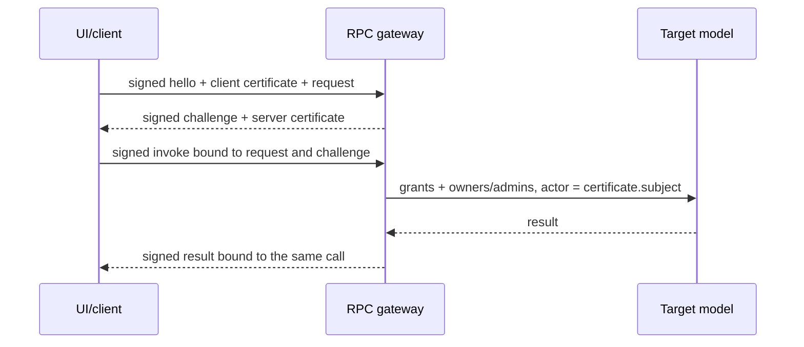

# Аутентифицированный RPC и удалённые модели

Реализованы взаимная проверка сертификатов, подписи ECDSA, одноразовый challenge,
ограничения прав и сетевой MVC-клиент. Проверки на ПК: `rpc/tests`,
`security/tests/signing_test.lua`, `security/tests/certificates_test.lua`,
`tests/rpc_system_test.lua`, `ui/tests/refresh_test.lua` и `tools/tests/pki_test.py`.
На настоящей Data Card/OpenOS эти сценарии ещё не выполнялись.

## Границы доверия

Все внешние вызовы моделей проходят сервис `rpc` на одном логическом порту
27016 через существующий транспорт (физический modem port 27015 либо tunnel 0).
Plain bus events, discovery и поля `player` внутри аргументов не дают права
вызова модели. Непосредственный arbitrary component invocation не предоставляется.

Доверие устанавливает локально настроенный публичный ключ CA. Discovery никогда
не становится источником такого ключа. Клиентский сертификат связывает публичный
ключ с `subject` — ником, component addresses, назначением client/server и grants.
На целевой модели actor берётся только из проверенного сертификата. После grants
дополнительно применяется обычная матрица owners/admins целевого контроллера.
Например, сертификат Admin с grant `configure` всё равно не даёт owner-only права.

Официальный OpenSecurity 1.7.10 не имеет нужного RSA/ECC API. Требуется явно
выбранный криптопровайдер. Предоставлен `security/signing_card.lua` для
OpenComputers Data Card Tier 3. Это отдельный компонент; OpenOS/BIOS не меняются.
Для форка OpenSecurity можно реализовать такой же контракт:

```lua
{
  random = function(length) return secureRandomBytes end,
  sha256 = function(bytes) return raw32Bytes end,
  sign = function(bytes) return signature end,
  verify = function(publicDer, bytes, signature) return boolean end,
}
```

Включение RPC без провайдера/подходящего ключа не открывает анонимный доступ.
При старте выполняется proof собственного приватного ключа против сертификата.
Несколько client identity разрешены, но выбираются по фактическому нику ввода.
UI не использует ключ Owner для удалённого запроса от имени Admin.

Подписи обеспечивают аутентичность и целостность. Этот RPC не шифрует сетевой
payload. Шифрование локальных логов является отдельным механизмом. Приватный ключ
identity даёт возможность действовать от её имени; CA-ключ на корабль не копируется.

## Протокол



Обе стороны проверяют сертификат CA, usage, адрес источника, подпись и привязку
к логическому порту/адресату. В hello подписаны request, ID и client nonce.
В challenge подписан SHA256 именно этого hello и свежий 256-bit challenge.
Invoke и result связаны с теми же ID, nonce, hash и challenge. ID/nonce/challenge
поступают из криптографического генератора; обычный OpenOS UUID здесь не используется.

Сервер потребляет challenge до диспетчеризации: повтор и повторный вход во время
обработчика не исполняют действие ещё раз. При потере result клиент повторяет
тот же invoke, сервер отдаёт сохранённый подписанный результат. Повтор старого
обмена после перезапуска/вытеснения кэша не может получить подпись клиента для
нового challenge. Клиент, уже отправивший invoke, не подписывает новый challenge
для того же запроса. Действие не перезапускается автоматически новым RPC-вызовом.

Challenge имеет TTL. Pending, кэш результатов и сериализованные данные ограничены
`maxSessions`, `maxPeer`, `maxBytes`, `maxFrame`. Выполненные ответы вытесняются
перед отказом новому вызову; они не заполняют квоту активных запросов peer навсегда.
Executing/неиспользованный challenge ради нового запроса не вытесняется.

`ETIMEDOUT` и `ERR_RPC_RESULT` могут означать неизвестный итог действия: действие
могло завершиться до потери ответа/энергии подписывающей карты. Встроенный retry
не повторяет действие, но оператору не следует считать новый вызов тем же retry.
Проверяйте состояние целевой модели. Поддержку фактических лимитов и задержек
Data Card необходимо проверить в игре; ошибка криптографии закрывает доступ.

## Формат сертификата и инструменты

Это сертификат приложения SpaceCross, не X.509-сертификат TLS. Публичный EC-ключ
внутри имеет формат X.509 SubjectPublicKeyInfo DER, приватный — PKCS8 DER.
Пример подписанного тела (сериализация — data-only codec):

```lua
{
  v = 1, issuer = "root", serial = "unique-serial", subject = "Owner",
  public_key = "DER bytes", addresses = {"client-card-address"},
  usage = {"client"}, grants = {power = {"snapshot"}, _system = {"models"}},
}
```

Внешний конверт — `{body=encodedBody, signature=ecdsaSignature}`.
Подписывается `"SpaceCross certificate v1\0" .. SHA256(encodedBody)` с
SHA256withECDSA. RPC использует другой domain prefix `"SpaceCross RPC v1\0"`.
Подпись сертификата нельзя использовать как подпись RPC и наоборот.

Сертификаты статические: доверенная wall clock в обычном OC не предполагается,
автоматического календарного expiration нет. Отзыв по serial настраивается через
`rpc.revoked` или `app.rpcTrust:revoke(serial)` и действует также между hello/invoke.
CA/public roots и revocation list обслуживаются явно, не из discovery.

Для PC-инструментов: `python3 -m pip install -r requirements-tools.txt`.
Пример генерации в игнорируемом локальном каталоге:

```sh
python3 tools/pki.py keygen --out .runtime/pki/root
python3 tools/pki.py keygen --out .runtime/pki/ui
python3 tools/pki.py keygen --out .runtime/pki/ship
```

Создать `.runtime/pki/reader-grants.json`:

```json
{"_system":["models"],"*":["snapshot"]}
```

Для управления добавить конкретные действия, например
`"autopilot":["setTarget","adjustTarget","go","navigate","route","cancel","startAutopilot","stopAutopilot"]`
и `"defense":["arm","disarm"]`. Target owners/admins по-прежнему проверяются.
Для server-only сертификата grants-файл содержит `{}`.

```sh
python3 tools/pki.py issue --ca-private .runtime/pki/root/private.der --public-key .runtime/pki/ui/public.der --subject Owner --address CLIENT-CARD-ADDRESS --usage client --grants .runtime/pki/reader-grants.json --out .runtime/pki/ui/client.cert
python3 tools/pki.py issue --ca-private .runtime/pki/root/private.der --public-key .runtime/pki/ship/public.der --subject Ship --address SHIP-CARD-ADDRESS --usage server --grants .runtime/pki/server-grants.json --out .runtime/pki/ship/server.cert
python3 tools/pki.py inspect .runtime/pki/ui/client.cert
```

`--address`/`--usage` можно повторить. Нужны реальные component addresses;
сертификат привязан к ним. Файлы не перезаписываются, приватные ключи создаются
с правами 0600. Inspect только показывает поля, не объявляет сертификат доверенным.
Фикстуры в `tests/stubs` содержат публичные тестовые private scalars; для установки
генерируются новые ключи. Python не требуется внутри OpenOS.

## API и UI

`config.example.lua` содержит все настройки `rpc`, CA-файлы и дополнительные
client identity. Собственный `certificateFile` и `crypto.privateKeyFile` должны
относиться к одному ключу. Пример вызова:

```lua
local value, err = app.rpc:request("remote-card", "power", "snapshot", "Owner", {})
local id, startErr = app.rpc:begin("remote-card", "autopilot", "navigate", "Owner",
  {target = {x = 10, y = 64, z = 0}})
-- Для async:
local ready, result, remoteError = app.rpc:poll(id)
local finalValue, finalError = app.rpc:take(id) -- освобождает handle
```

`request` вызывает штатный OpenOS event.pull через injected wait, поэтому
энергетические/оборонительные таймеры продолжают обслуживаться. `stop` завершает
ожидающие вызовы с ESHUTDOWN. `stats` содержит accepted/denied/executed/timeouts/faults;
executed — число диспетчеризаций модели. Denied/faults суммируются в async log,
чтобы один неверный пакет не создавал отдельный log-файл каждый раз.

В Network вкладке щёлкнуть строку `model @ address`. Перед открытием вызывается
подписанный `_system.models`, затем проверяется наличие модели. Power/Hardware/
Entities объединяют endpoints нескольких выбранных контроллеров в одну вкладку.
Autopilot/Defense имеют отдельные вкладки по целям, чтобы команда не попала
одновременно на несколько кораблей. Повторный выбор снимает компонент.
Алиасы одного подтверждённого ключа+subject не добавляются дважды.

Кэшируются только сертификаты и endpoint-настройки представления. Снимки модели
на неактивных вкладках не хранятся/не запрашиваются. При возвращении вкладка
получает новые snapshot. Если пользователь меняет вкладку во время ожидания RPC,
старый ответ не рисуется. Remote UI и его отключение не управляют жизненным
циклом автономного целевого контроллера.
